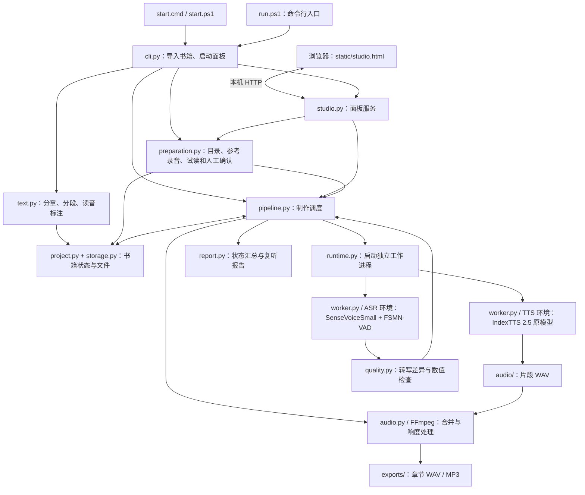
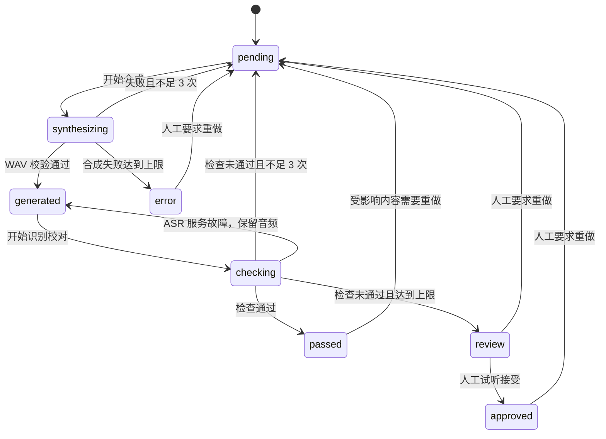

# 说书人 · 项目架构

当前实现以 Windows 本地、单音色、中文 TXT 有声书制作为主线。原始 IndexTTS 2.5 负责按参考录音克隆音色，SenseVoiceSmall 与 FSMN-VAD 负责辅助校对，FFmpeg 负责音频转换和章节导出。

当前 `config.local.json` 的 `tts_adapter` 为空。训练模块和训练产物作为独立实验保留，与日常制作流程分开。本文包含项目目录及模块职责，日常操作见 [使用说明](../README.md)。

## 1. 总体结构



本地控制进程保存状态、接收操作和调度任务。重型语音模型运行在子进程里；正常制作按章节先合成、后校对，两个模型阶段依次运行。

## 2. 目录与职责

```text
说书人/
├─ README.md                用户使用说明
├─ docs/                   架构和维护说明
├─ start.cmd / start.ps1    文件选择与制作面板入口
├─ run.ps1                 命令行入口
├─ setup.ps1               安装本地环境与准备模型
├─ config.local.json       当前机器配置：原模型
├─ config.example.json     常用制作配置示例
├─ storyteller/            控制端、工作进程和面板服务
│  └─ static/studio.html    面板前端
├─ scripts/                启动、安装、训练工作流与公共函数
│  └─ bootstrap/           PyTorch、模型和分块下载准备脚本
├─ requirements/           控制端安装辅助依赖与 ASR 固定版本
├─ requirements-asr.txt    旧依赖路径的兼容入口
├─ tests/                  数值校对、配置、面板、分章与续跑回归
├─ books/                  每本书的输入、状态、音频和成品
├─ 01_语音 / 02_标注       用户提供的原始音频与标注
├─ training/               训练清单、特征和权重
├─ train_voice.ps1          独立训练工具入口
├─ pyproject.toml          Python 包和 shuoshu 命令定义
├─ archive/                恢复快照与清理清单
├─ .runtime/               Python 环境、模型、源码、缓存和显卡锁
└─ .tools/                 安装阶段使用的工具
```

`books` 是业务数据目录，`storyteller` 是当前业务实现。根目录 PowerShell 文件转发到 `scripts/` 中的对应工作流，恢复材料见 [归档索引](../archive/README.md)。

新增业务逻辑放入 `storyteller/`，操作脚本放入 `scripts/`，安装专用工具放入 `scripts/bootstrap/`，回归测试放入 `tests/`。文档在 `docs/` 维护，并从根目录 README 导航。`build/`、`dist/`、`*.egg-info/` 与 `__pycache__/` 为可重新生成的文件。

原始素材继续使用 `01_语音/` 和 `02_标注/`，训练清单引用了其绝对路径。训练数据集与运行分别放在 `training/<数据集>/`、`training/<数据集>/runs/<运行名>/`，每本书放在 `books/<书名>/`。Python 的 `storyteller.config.ROOT` 和 PowerShell 入口均从源码位置确定项目根目录。

| 模块 | 主要职责 | 关键接口 |
|---|---|---|
| `cli.py` | 解析命令，连接导入、试读、制作、复听和环境检查 | `parser()`、`main()` |
| `config.py` | 默认配置、本机覆盖、书籍配置恢复、生成档案与模型签名 | `load_config()`、`load_book_config()`、`generation_profile()` |
| `text.py` | 编码识别、标题识别、分段、数值和词条边界保护、原字读音标注 | `read_book()`、`split_chapters()`、`split_segments()` |
| `project.py` | 书籍初始化、片段状态、缓存修复、手工重做、批准与旧成品归档 | `create()`、`refresh()`、`retry()`、`approve()` |
| `preparation.py` | 章节重划、参考截取、试读复用、制作前确认、设置与听感记录 | `preview()`、`confirm()`、`replan()`、`record_listening()` |
| `pipeline.py` | 逐章调度合成和校对、控制重试、保存阶段结果、导出就绪章节 | `run()`、`_stage()`、`export_ready()` |
| `runtime.py` | 检查资产、生成任务请求、启动子进程、解析事件、取消与超时处理 | `prerequisites()`、`StageRunner.events()` |
| `worker.py` | 加载 TTS 或 ASR，逐项执行请求，返回事件 | `tts_model()`、`asr_model()`、`main()` |
| `compat.py` | 处理 Windows 中文路径下的原生 FST、SentencePiece 文件加载 | `prepare_wetext()`、`unicode_sentencepiece()` |
| `quality.py` | 规范化等价写法、计算转写差异、检查关键数值及音频异常 | `normalize()`、`evaluate()` |
| `audio.py` | 参考音频转换、WAV 检查、片段拼接、两遍响度处理、MP3 编码 | `prepare_reference()`、`wav_info()`、`export_chapter()` |
| `report.py` | 生成汇总、HTML 复听报告和 CSV 清单 | `summarize()`、`write_report()` |
| `storage.py` | JSON 原子保存、哈希、路径约束、操作系统文件锁 | `write_json()`、`file_hash()`、`FileLock` |
| `studio.py` | 本地 HTTP 接口、后台制作任务、暂停、音频访问与下载 | `Studio`、`StudioServer`、`serve()` |

## 3. 运行环境和进程

| 组件 | 路径 | 运行内容 |
|---|---|---|
| 控制端 | `.runtime/core/Scripts/python.exe` | CLI、HTTP 面板、状态调度、报告；业务逻辑使用 Python 标准库 |
| TTS 子进程 | `.runtime/index-tts/.venv/Scripts/python.exe` | 本地 IndexTTS 源码、PyTorch、原始模型及辅助编码器 |
| ASR 子进程 | `.runtime/asr/Scripts/python.exe` | FunASR、SenseVoiceSmall、FSMN-VAD |
| FFmpeg 进程 | 由配置或本地安装目录解析 | 参考音频解码、响度处理、章节 WAV 和 MP3 |

IndexTTS 源码在 `.runtime/index-tts`，原模型在 `.runtime/models/index-tts-2.5`；识别模型分别位于 `.runtime/models/sensevoice-small` 和 `.runtime/models/fsmn-vad`。

TTS 侧保留上游模型结构：使用参考录音的语音及说话人特征，经过 GPT、语音 codec、声学解码和 BigVGAN 输出波形。项目控制层负责文本、调度、校对与成品管理，不重新训练或改写原模型权重。正常合成使用中文语言参数，关闭情绪文本模型，按固定随机种子生成。

### 工作进程协议

1. 控制端将阶段、配置和任务数组写入书籍的 `.jobs/<stage>-<uuid>.json`。
2. `StageRunner` 使用对应 Python 环境运行 `-m storyteller.worker 请求文件`。
3. 模型加载后返回 `ready`；逐段返回 `started`、`done` 或 `error`。
4. 事件通过标准输出传输，前缀为 `@@SHUOSHU@@`，内容为 JSON。诊断日志写入 `logs/<stage>-<uuid>.log`。
5. 控制端在事件到达时更新 `project.json`。阶段结束后子进程退出，释放模型占用的显存。

超时按“没有返回进度的持续时间”计算。暂停或异常退出时，运行器终止子进程并关闭管道，控制端保存已处理进度。

## 4. 一次制作的数据流

1. **导入**：读取 TXT，解析章节和段落；验证读音规则、参考录音和输出目录，再复制原始输入并创建 `project.json`。
2. **准备**：用户核对章节和参考声音；试读使用同一条制作流水线，只处理选定开篇片段，并生成 `preview/voice.wav`。
3. **确认**：记录目录和试读确认。试读哈希、声音或生成档案改变后，原确认不能直接沿用。
4. **合成**：每段按编号、尝试次数生成任务和随机种子；每次尝试使用独立 WAV，避免覆盖历史。
5. **校对**：SenseVoice 返回转写；`quality.py` 比较原文、数字、符号、连续差异、时长和音量。
6. **重试或复听**：机器检查未通过且尝试不足 3 次时重新合成；达到上限后进入人工复听。ASR 服务故障保留已生成音频，恢复后继续校对。
7. **导出**：整章只包含已通过、人工批准或场景停顿时，按序拼接并用 FFmpeg 导出。
8. **报告**：保存汇总、异常清单和可播放的离线报告；用户可在面板补充听感记录。

## 5. 片段状态



`pause` 是纯标点分隔行的独立状态，作为场景停顿导出，不调用语音模型。章节可导出的状态集合为 `passed`、`approved`、`pause`。

每段同时保留本轮自动尝试次数 `attempts` 和累计次数 `total_attempts`。人工重做重置本轮计数，历史尝试和累计复听记录仍保留。进程中断遗留的 `synthesizing`、`checking` 状态会在续跑时恢复为可处理状态。

## 6. 持久化与续跑

`project.json` 是书籍状态的主要记录，不使用数据库。它保存输入哈希、生成档案、书籍设置、章节、片段、每次尝试、校对结果、准备确认、章节导出和运行历史。

| 发生变化的位置 | 处理方式 |
|---|---|
| 原文副本、固定参考音频或生成档案 | 校验一致性，拒绝静默混用不同书稿或音色 |
| 片段音频 | 校验 SHA-256，缺失或改变时按需重新生成 |
| 读音词典及受保护的切分边界 | 修复受影响片段，保留其他片段的编号和音频 |
| QA 版本或阈值 | 对受影响的机器通过结果重新校对，复用语音 |
| 停顿、响度、码率或导出文件 | 重新导出；失效成品移到 `exports/history` |
| 合成成功但 ASR 进程失败 | 保留 `generated`，下次继续识别 |

章节导出签名包含音频内容哈希、停顿及导出参数，同时核对 WAV、MP3 内容哈希，避免仅凭文件存在就误用损坏成品。

JSON 通过临时文件、刷盘和替换保存；Windows 的短暂文件占用采用有限重试。`status` 读取已保存快照，不申请项目写锁。

### 锁和并发

- 书籍 `.project.lock`：保护该书的状态修改、重做、批准与导出。
- 全局 `.runtime/gpu.lock`：同一时刻只允许一个制作、模型检查或训练任务使用显卡。
- `.runtime/model-revisions.lock`：保护安装阶段的模型版本记录。

操作系统在进程退出后释放文件锁。面板通过后台线程执行制作，HTTP 查询保持可用；同时编辑同一项目的写操作会受锁或任务状态约束。

## 7. 配置和模型选择

新书的配置读取顺序为代码 `DEFAULTS` 加本机 `config.local.json`，或显式传入的配置文件。嵌套设置按键合并，未知项会拒绝。

`inference_gap_ms` 是固定的片段内部生成停顿，与可修改的章节拼接停顿 `gap_ms` 分开保存。旧 `sentence` 书籍从保存的初始停顿恢复该值；旧 `legacy` 书籍沿用 200 毫秒。续跑校验内部停顿，界面调整普通段间停顿只使章节导出失效，不改变片段音频或试读声音。`qa.critical_terms` 与正文采用相同规范化；校对版本升级会让机器通过片段重新进入识别阶段。

已有书籍读取当前机器的运行时路径，再恢复 `project.json` 中保存的书籍设置；显式 `--config` 中列出的书籍项可进一步覆盖。模型版本、精度、语速及启用的适配器内容形成生成档案，续跑时核对一致性。

当前原模型路径：

```text
config.local.json: tts_adapter = ""
        ↓
worker.tts_model()
        ↓
.runtime/models/index-tts-2.5/gpt.pth + 上游辅助模型
        ↓
原始 IndexTTS 2.5 推理
```

代码仍保留显式加载适配器的能力，只有配置提供非空适配器路径才会使用。本机默认配置和现有书籍均已核对为原模型。

## 8. 本地面板与离线边界

面板仅监听 `127.0.0.1`。`/api/state` 返回状态，`/api/source` 提供原稿视图，`/api/action` 执行操作，`/media/` 提供限定目录中的音频和成品，支持范围读取。

服务使用随机会话令牌，并检查 Host、请求来源和媒体路径。页面文本与复听报告进行转义，书籍数据路径限制在相应目录内。

安装阶段由 `setup.ps1` 转发到 `scripts/Setup-Environment.ps1`，再调用 `scripts/bootstrap/prepare_models.py` 联网准备资源，使用固定源码版本、记录的模型版本、分块续传和 SHA-256。制作阶段设置离线环境变量，并在模型工作进程中阻断 Python socket 连接。这里的离线限制作用于工作进程，未关闭 Windows 的网络适配器。

## 9. 环境检查与维护

```powershell
# 校验模型内容并依次真实加载 TTS 和 ASR。
.\run.ps1 doctor --verify-hashes --load-models
```

真实加载检查验证运行环境，不代替指定声音的实际试听。自动校对也不负责判断音色相似度、情绪和长篇自然度。

训练相关代码为 `training_data.py`、`finetune.py`、`lora.py`；`train_voice.ps1` 转发到 `scripts/Train-Voice.ps1`。训练数据清单、特征及检查点保存在 `training/`，详见 [训练目录说明](../training/README.md)。
